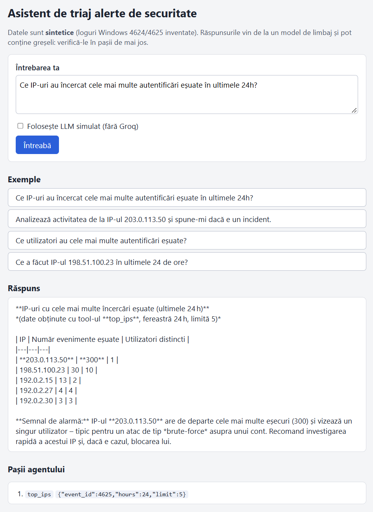

# Asistent de triaj alerte de securitate


Proiect mic cu **Python, Flask, SQLAlchemy și un agent LLM cu tool calling (Groq)**. Pui o întrebare în română
despre autentificări Windows (de exemplu *„Ce IP-uri au încercat cele mai multe autentificări eșuate în ultimele 24h?"*),
iar agentul alege singur dintre **3 tool-uri fixe**, interoghează o bază SQLite și răspunde cu un rezumat.

> **Datele sunt sintetice.** Toate logurile sunt generate de cod (adrese IP din intervalele rezervate pentru
> documentație, utilizatori inventați). Nu există date reale. Nu se pot trage concluzii despre un mediu real.



*Captură reală, cu modelul Groq. Se vede și limita cunoscută: tabelul Markdown din răspuns apare ca text simplu.*

## Cum funcționează

1. **Date:** `generate_data.py` creează ~1900 de evenimente Windows (Event ID 4624 = login reușit, 4625 = eșuat) cu scenarii
   ascunse: un brute-force urmat de un login reușit, un password spraying, un atac mai vechi de 24h și un utilizator real
   care își blochează contul (fals pozitiv).
2. **Tool-uri fixe** (`tools.py`): `search_events`, `count_failures`, `top_ips`. Parametrii sunt validați (interval de ore,
   limită, valori permise) și interogările sunt construite cu SQLAlchemy.
   **Modelul nu scrie SQL**: alege un tool și îi dă parametri.
3. **Agent** (`agent.py`): o buclă care trimite întrebarea și schemele tool-urilor la LLM, execută tool-ul cerut, îi întoarce
   rezultatul și repetă (maxim 5 runde) până primește răspunsul final. Un tool inexistent, JSON stricat sau parametri
   invalizi nu opresc agentul: modelul primește un mesaj de eroare.
4. **Interfață** (`app.py`): API REST Flask (`POST /api/ask`) și o pagină HTML cu Jinja care arată răspunsul și **pașii
   agentului** (ce tool a ales, cu ce parametri).

## Cum îl rulezi

Cerințe: Python 3.12.

```bash
python -m venv .venv
# Windows: .venv\Scripts\activate      Linux/macOS: source .venv/bin/activate
pip install -r requirements.txt
python -m asistent_triaj.generate_data       # creează events.db (date sintetice)
python -m asistent_triaj.app                 # pornește serverul pe http://127.0.0.1:5000
```

Fără cheie Groq poți folosi bifa **„LLM simulat"** din pagină. Pentru modelul real, creează un fișier `.env` (modelul
din `.env.example` e doar un exemplu; poți pune alt model Groq cu tool calling):

```
GROQ_API_KEY=cheia_ta_de_pe_console.groq.com
GROQ_MODEL=openai/gpt-oss-120b
```

`.env` este în `.gitignore`: nu îl urca pe GitHub. Din linia de comandă: `python -m asistent_triaj.ask "întrebarea ta"`
(adaugă `--fake` pentru LLM-ul simulat).

### API

```bash
curl -X POST http://127.0.0.1:5000/api/ask -H "Content-Type: application/json" \
     -d '{"question": "Ce utilizatori au cele mai multe autentificări eșuate?", "simulated": true}'
```

Răspuns: `{"answer": "...", "steps": [{"tool": "...", "arguments": "...", "result": {...}}]}`.
Erori: `400` (întrebare lipsă, prea lungă sau cerere fără JSON), `502` (Groq indisponibil sau cheie lipsă).
`GET /api/health` verifică dacă serverul rulează.

## Teste

```bash
pip install -r requirements-dev.txt
python -m pytest -q
```

Testele (tools, agent, aplicația Flask) rulează cu un **LLM simulat**: nu au nevoie de cheie și nici de internet.
Aceleași teste rulează în GitHub Actions (`.github/workflows/ci.yml`), fără nicio cheie.
Testele verifică codul din jurul modelului (validare, buclă, erori, HTML scăpat în pagină), **nu calitatea răspunsurilor
unui model real**.

## Structura

```
asistent_triaj/
  db.py            tabelul de evenimente (SQLAlchemy + SQLite)
  generate_data.py generatorul de loguri sintetice
  tools.py         cele 3 tool-uri fixe, cu validarea parametrilor
  agent.py         bucla agentului, schemele tool-urilor, promptul de sistem
  groq_llm.py      clientul Groq (cheia din .env)
  fake_llm.py      LLM simulat pentru teste
  app.py           Flask: pagina Jinja + API REST
  ask.py           întrebare din linia de comandă
  templates/ static/
tests/             teste pytest
docs/              captura paginii (pagina.png)
.github/workflows/ ci.yml: rulează testele în GitHub Actions
Dockerfile         netestat (vezi mai jos)
LICENSE            licența MIT
```

## Docker (netestat)

Repo-ul conține un `Dockerfile`, dar **autorul nu l-a construit și nu l-a rulat niciodată** (nu are Docker instalat).
Poate conține greșeli. Dacă îl încerci: `docker build -t asistent-triaj .` și
`docker run --env-file .env -p 127.0.0.1:5000:5000 asistent-triaj`.

## Limite

* Date sintetice, construite de mine împreună cu Claude: un mediu real are alt volum, alt zgomot și alte tipuri de atac.
* Calitatea răspunsurilor depinde de modelul LLM și poate varia de la o rulare la alta. Am verificat manual doar câteva
  întrebări; **nu am măsurat acuratețea**. Într-un caz modelul a raportat greșit un total (a numărat lista returnată, nu
  totalul real); am corectat promptul, dar alte greșeli sunt posibile. Răspunsurile trebuie verificate în „pașii agentului".
* Doar 3 tool-uri și doar evenimentele 4624/4625; fără corelare între surse, fără istoric de conversație.
* Apărarea împotriva *prompt injection* se rezumă la promptul de sistem și la faptul că modelul nu poate executa decât cele
  3 tool-uri validate. Nu este o garanție.
* Aplicație locală: fără autentificare, fără limitare de cereri, server Flask de dezvoltare. **Nu este pregătită pentru
  producție** și nu înlocuiește un SIEM.
* Pagina afișează răspunsul ca text simplu (tabelele Markdown nu sunt desenate).

## Realizat cu ajutorul AI

Am realizat acest proiect împreună cu **Claude** (asistent AI de la Anthropic). Eu am ales tema, am stabilit direcția,
am rulat și am verificat fiecare etapă. Claude a scris codul, testele și acest README. Nu pretind că am scris codul singur.

## Licență

MIT, vezi [LICENSE](LICENSE). Autor: **VibeStorm**.
